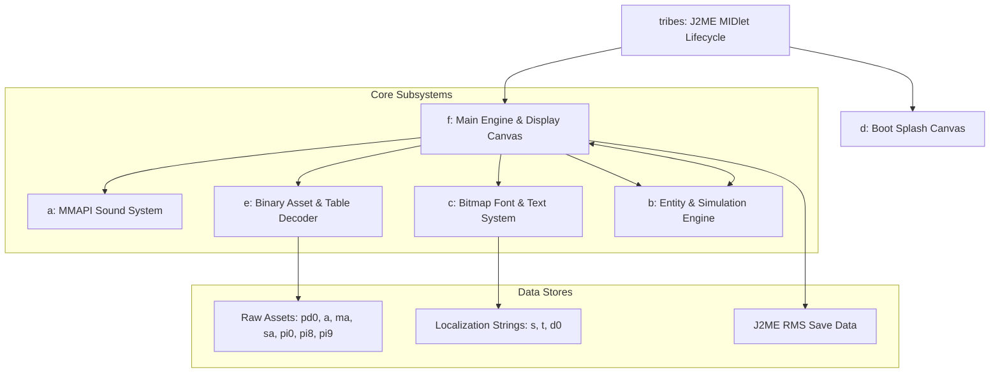

# Phase 3: Java Architecture & System Analysis

This document details the reverse-engineered software architecture of *Prehistoric Tribes* based on CFR decompilation with member deobfuscation.

---

## 1. High-Level Architecture Overview

---

## 2. Subsystem Deobfuscation & Responsibilities

### 2.1. `tribes.java` — Application Entry Point
- **Superclass:** `javax.microedition.midlet.MIDlet`
- **Interfaces:** `java.lang.Runnable`
- **Role:** Handles device application lifecycle events:
  - `startApp()`: Acquires the `Display` singleton, spawns the main worker thread.
  - `pauseApp()`: Forwards background pause notification to `f`.
  - `destroyApp(boolean)`: Gracefully terminates active threads and releases resources.
  - `run()`: Sequential boot sequence:
    1. Instantiates `d` (Splash Canvas) and displays publishers' logos (`l0` -> `l1` -> `l2`).
    2. Pauses using `Thread.sleep` for timed splash transitions.
    3. Instantiates `f` (Main Game Canvas), attaching it to the active `Display`.

### 2.2. `d.java` — Boot & Splash Canvas
- **Superclass:** `javax.microedition.lcdui.Canvas`
- **Role:** Full-screen (`setFullScreenMode(true)`) temporary graphics canvas. Renders:
  - Frame 0: White background with publisher logo (`/l0` — THQ Wireless).
  - Frame 1: Developer logo (`/l1` — Gear Games).
  - Frame 2: Main promotional art (`/l2` — Prehistoric Tribes title).

### 2.3. `a.java` — Audio Subsystem
- **Interfaces:** `javax.microedition.media.PlayerListener`
- **Role:** Wrapper around J2ME Mobile Media API (`javax.microedition.media.Manager`).
- **Mechanics:**
  - Creates a playback stream from byte buffer `f.var_byte_arr_w` (extracted `/sa`).
  - Implements track slicing using `ByteArrayInputStream(data, offset, length)`.
  - Controls playback volume through `javax.microedition.media.control.VolumeControl` with 5 levels (`level = n * 20`).
  - Manages audio interruptions via `playerUpdate(Player, String, Object)` for `deviceUnavailable` and `deviceAvailable` system events.

### 2.4. `e.java` — Binary Resource & Data Table Unpacker
- **Role:** Static and dynamic data initialization. Decodes binary packages into fast memory structures:
  - `/pd0`: Unpacks 11 `short[]` coordinate arrays and 25 `byte[]` lookup tables that define sprite UV boundaries.
  - `/ma`: Stores raw compressed byte arrays and initializes map scenario offset pointers.
  - `/a`: Unpacks 312 animation descriptors and 5 movement direction tables.
  - Slices PNG images `pi0` (UI) and `pi9` (Units) by reading lengths and instantiating immutable `Image` objects.
  - Reads JAD/Manifest properties (`MIDlet-Version`, `Cheat-Support`, `GameLinkEnabled`).

### 2.5. `c.java` — Proportionally-Spaced Bitmap Font & Text System
- **Role:** Specialized text rendering and string table navigation engine.
- **Mechanics:**
  - Directly reads `/s`, `/t`, and `/d0` text files at runtime based on active language ID (0 to 4).
  - Implements proportional character width computation: Characters are indexed into sprite sheets with custom width and kerning adjustments.
  - Supports string interpolation for dynamic variables (e.g., character names, remaining building resources).
  - Implements auto-scrolling dialogue dialogs and line-wrapping algorithms with hyphenation logic.

### 2.6. `f.java` — Game Canvas, UI & Graphics Pipeline
- **Superclass:** `javax.microedition.lcdui.Canvas`
- **Interfaces:** `java.lang.Runnable`
- **Key Fields:**
  - `var_byte_q`: Active campaign level index (0 to 9).
  - `var_byte_v`: Engine state flag (`0` = Menu/Dialog mode, `1` = In-game simulation).
  - Double buffer offscreen images: `264 x 352` (gameplay) and `240 x 320` (screen canvas).
- **Core Loop (`run()`):**
  - Target frame rate: ~20 FPS (50 ms target sleep interval with delta-time compensation).
  - Step 1: Input polling (`aS()`).
  - Step 2: Game tick increment (`h()`).
  - Step 3: Simulation state update (`m()` delegating to `b`).
  - Step 4: Canvas repaint and screen blit (`paint()`).

### 2.7. `b.java` — Core Simulation & Entity Logic
- **Architecture:** Structure-of-Arrays (SoA) layout flattened into single contiguous arrays (`this.var_byte_arr_a`, `this.var_short_arr_a`).
- **Entity Pool:** Exactly 101 entities (units, wild animals, projectiles, interactive buildings).
- **Property Stride:** Properties are indexed by multiples of 101:
  - `+ 0`: Tile coordinate X.
  - `+ 101`: Tile coordinate Y.
  - `+ 808`: Direction / facing orientation (0 to 7).
  - `+ 2828`: Entity action state / job type.
  - `+ 3131`: Target destination X.
  - `+ 3232`: Target destination Y.
  - `+ 4848`: Entity state timer / action progress.
  - `+ 6262`: Secondary navigation waypoint X.
  - `+ 6363`: Secondary navigation waypoint Y.
  - `+ 7979`: Health points / energy.

---

## 3. Rendering Pipeline & Isometric Math

### 3.1. Isometric Projection Coordinate Space
The game uses a standard 2:1 isometric tile projection:
- **Tile Width ($W$):** 44 pixels.
- **Tile Height ($H$):** 32 pixels.
- **Half-Tile Steps:** $dx = 22$, $dy = 16$.

$$\begin{aligned}
\text{Screen } X &= (X_{\text{tile}} - Y_{\text{tile}}) \times 22 - \text{Camera}_X \\
\text{Screen } Y &= (X_{\text{tile}} + Y_{\text{tile}}) \times 16 - \text{Camera}_Y
\end{aligned}$$

### 3.2. Reverse Picking (Screen to Tile Coordinates)
Converting a screen pixel $(px, py)$ back to an isometric grid tile $(tx, ty)$ is accelerated using pre-computed diamond scanline masks in `/a`:
1. Find candidate diamond bounding box.
2. Lookup horizontal offset in scanline mask table.
3. Determine exact tile index without floating point division.

---

## 4. Save/Load Persistence System (`RMS`)

Game progress is saved using J2ME Record Management System (`javax.microedition.rms.RecordStore`):
- **Store Name:** `"prehist_save"` or dynamically generated from MIDlet vendor prefix.
- **Payload Structure:**
  - Header byte: Save version and campaign level.
  - Resource counts (Food, Wood, Stone, Bones) stored as 16-bit integers.
  - Living population count and individual villager stats (Name index, Gender, Age, Skills, Happiness).
  - Placed buildings table (Type, Level, Grid Coordinates, Damage).
