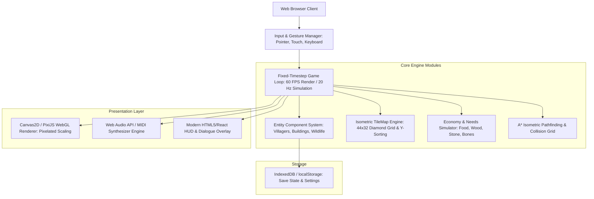

# Phase 6: Web Remake Technical Specification

This document provides a modern software architecture, component specification, and implementation roadmap for remaking *Prehistoric Tribes* as an authentic yet modernized Web-based 2D strategy game.

---

## 1. Target Web Architecture

---

## 2. Technology Stack Recommendation

| Layer | Recommended Choice | Rationale |
|---|---|---|
| **Language** | TypeScript | Strong typing prevents state desynchronization and enables clear entity schema definitions. |
| **Rendering** | PixiJS or HTML5 Canvas2D | High-performance 2D sprite rendering with native pixel-art nearest-neighbor scaling (`image-rendering: pixelated`). |
| **Game Architecture** | Lightweight Entity Component System (ECS) | Replaces the obfuscated 101-stride array (`b.java`) with clean decoupled components (`Position`, `Vitals`, `Job`, `Inventory`, `Combat`). |
| **Pathfinding** | A* on Isometric Grid | Replaces primitive J2ME line-stepping with robust obstacle avoidance around buildings and natural hazards. |
| **Audio Subsystem** | Web Audio API + SoundFont synthesizer (e.g. `spessasynth_lib` or `timidity`) | Enables native playback of the 5 extracted `.mid` files with classic 90s/2000s General MIDI sound. |
| **Asset Pipeline** | Extracted PNGs + Webpack / Vite | Original extracted PNGs (`pi0.png`, `pi9.png`, `l2.png`) are already preserved and ready for immediate web use. |
| **State Persistence** | `localStorage` / `IndexedDB` | Seamless save/load replacing J2ME `RecordStore`. |

---

## 3. Core Component Mapping (Original $\rightarrow$ Modern Web)

| J2ME Class | Web Implementation | Architecture Mapping |
|---|---|---|
| `tribes.class` | `GameApp.ts` | Initializes Canvas viewport, manages asset preloading, boots game state. |
| `d.class` | `SplashScene.ts` | Renders high-res splash sequences (`l0`, `l1`, `l2`) with smooth CSS/WebGL fade transitions. |
| `a.class` | `AudioManager.ts` | Manages track playback (`music_track_0` through `4`), volume sliders, and sound effects. |
| `c.class` | `TextRenderer.ts` / DOM HUD | Parses `0/s`, `0/t`, `0/d0` JSON/text tables; renders retro pixel fonts or sharp scalable web fonts. |
| `e.class` | `AssetLoader.ts` | Loads texture atlases, slices spritesheet frames, parses map binary blocks (`.bin`). |
| `f.class` | `IsometricScene.ts` | Viewport camera pan/zoom, diamond coordinate transformations, Y-sorted rendering. |
| `b.class` | `SimulationEngine.ts` | Villager autonomous needs loop, resource gather/deposit, combat checks, and building progress. |

---

## 4. Modern UX & Controls Enhancements

The original J2ME controls were restricted to mobile keypad buttons (`2, 4, 6, 8, 5, *, #, LSK, RSK`). The Web remake elevates the experience to modern RTS/City-Builder standards:

1. **Direct Pointer Interaction:**
   - **Left-Click:** Select villager, building, or resource node.
   - **Right-Click:** Contextual command (move to position, chop tree, mine rock, attack enemy, garrison into tower).
   - **Click & Drag (Box Selection):** Select multiple warriors simultaneously for tactical combat.
2. **Camera Controls:**
   - **Middle-Mouse Drag / WASD / Arrow Keys:** Smooth continuous camera scrolling across the isometric map.
   - **Mouse Wheel:** Smooth camera zoom (1x, 2x, 3x retro integer scaling).
3. **Control Groups & Hotkeys:**
   - `Ctrl + 1-9`: Assign selection hotkey group.
   - `Space`: Center camera on selected unit or Chief.
   - `C`: Instant "Call to Arms!" trigger.
   - `B`: Open construction menu.
4. **Enhanced HUD:**
   - Persistent top bar showing Food, Wood, Stone, Bones, Living Space, and Population.
   - Selected unit inspector in bottom-left displaying portraits, needs bars (Hunger, Fatigue, Happiness), and equipped weapons.
   - Mini-map with real-time fog-of-war in bottom-right corner.

---

## 5. Development Milestones & Roadmap

- **Milestone 1: Prototype Renderer**
  - Implement 2:1 isometric tile math ($44 \times 32$ pixels).
  - Render Level 0 map (`00_outside.bin`) using tiles sliced from `pi0.png`.
  - Camera dragging and zoom controls.
- **Milestone 2: Entity & Animation Engine**
  - Unpack unit frames from `pi9.png`.
  - Implement 8-directional walking and idling animations.
  - Implement A* isometric grid pathfinding.
- **Milestone 3: Economic & Construction Loop**
  - Implement tree chopping and stone quarrying.
  - Implement building footprint placement, resource deduction, and construction progression.
- **Milestone 4: Villager Simulation & AI**
  - Implement Hunger, Fatigue, and Happiness decay timers.
  - Implement autonomous task switching (travel to Kitchen to eat, sleep in Hut, dance at Disco).
  - Implement reproduction ("tent-time") and child aging.
- **Milestone 5: Combat & Campaign Scenarios**
  - Implement weapons manufacturing, militia rallying ("Call to Arms!"), and enemy raiding waves.
  - Implement Shaman spellcasting (Healing, Ward, Love Potion, Disease).
  - Load and sequence all 10 campaign scenarios with authentic dialogue popups from `0/d0`.

---

## 6. Verified 1:1 Offline Web Clone & React Edition (`4_prehistoric_tribes_clone/` & `5_prehistoric_tribes_react/`)

*(Note: The legacy prototype `3_web_game/` has been removed and replaced by the React + TypeScript edition `5_prehistoric_tribes_react/`.)*

A faithful offline 1:1 clone of `https://prehistoric-tribes.vercel.app/` is maintained and verified at [`../../4_prehistoric_tribes_clone/`](../../4_prehistoric_tribes_clone/) (documented in [`CLONE_ARCHITECTURE.md`](../../4_prehistoric_tribes_clone/CLONE_ARCHITECTURE.md)), alongside its Vite + React + TypeScript wrapper at [`../../5_prehistoric_tribes_react/`](../../5_prehistoric_tribes_react/):

- **1:1 Engine & Pixel Scaling:** [`assets/index-BHVz0EiT.js`](../../4_prehistoric_tribes_clone/assets/index-BHVz0EiT.js) and [`assets/index-DT5HQrea.css`](../../4_prehistoric_tribes_clone/assets/index-DT5HQrea.css) match `.orig.js` and `.orig.css` byte-for-byte, rendering on a logical `1x` canvas (`640×400` at `1280×800` desktop viewport) with `image-rendering: crisp-edges`.
- **Self-Contained Local Assets:** `48` `1x` PNGs in [`res/images/`](../../4_prehistoric_tribes_clone/res/images) plus `res/icon.png`, `res/data/game-data.json` (`288 tables + 4 shortTables`), `res/data/sprites.json` (`11 shorts + 25 bytes`), `10` RLE maps (`res/maps/map-0..9.bin`), `5` JSON locales (`en, fr, it, de, es` with `235` dialogues), and `5` MP3 soundtrack files (`music/song0..4.mp3`). (`assets/hd-graphics.js` and `res/images-hd/` remain dormant backups unreferenced at runtime.)
- **Local Dev Service Worker Hygiene:** [`registerSW.js`](../../4_prehistoric_tribes_clone/registerSW.js) unregisters stale Service Workers on page load to ensure local asset updates reflect cleanly.
- **Runtime Validation:** Headless Chrome (`1280×800`) confirmed HTTP `200` asset loads, `0` runtime/console/network errors (`ERRS: []`), and pixel-accurate Title, Story (`OUTSIDE`), Gameplay HUD, Minimap (`3`), and Pause Menu (`RESUME / SAVE / OPTIONS / HELP / QUIT`) screens.
